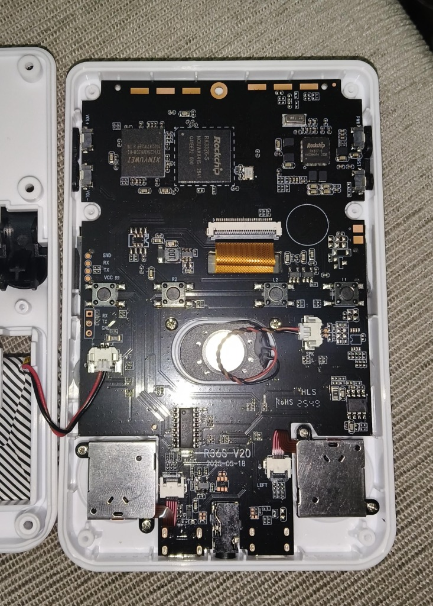

# dArkOSen-K36

[🇧🇷 Leia em Português (README.pt-BR.md)](README.pt-BR.md)

Hybrid OS builder, calibrated Device Trees (`DTS`/`DTB`), and hardware overlay to run **dArkOSen (Debian GNU/Linux 13 "Trixie", `glibc 2.41`, SDL2 `2.32.10`)** on **R36S-V20 `2025-05-18` (batch `2549`) / K36** clone handhelds equipped with the **Rockchip RK3326-S** SoC and **Xinyuwei `XY6C256M32DM-H2` (768 MB real RAM @ 328 MHz)**.

---

## Why does this project exist?

Owners of the **R36S-V20 `2025-05-18` (batch `2549`) / K36** clone revision were stuck between two dead ends:

- **Modern images (dArkOSen, ArkOS, dArkOS4Clone on Kernel `4.4.189`):** Fail to boot (black screen or immediate freeze), even when using beta V20 `2025-05-18` DTBs.
- **Working stock / ArkOS K36 image (Kernel `5.10.160`):** Boots properly, but ships with an obsolete **Ubuntu 19.10 (`glibc 2.30`)** rootfs from 2019 — breaking almost all modern **PortMaster** ports and runtimes that require `glibc 2.34+` / `2.38+`.

**The solution:** Keep the proven low-level hardware layer (**`DDR V2.08 @ 333 MHz` bootloader + clean `5.10.160` kernel + calibrated DTB**) and run the full **dArkOSen Debian 13 (`glibc 2.41`)** root filesystem on top of it (`ext4`).

---

## Forensic Hardware Findings (`R36S-V20 2025-05-18 2549`)

### Reference Motherboard Photo
If you're unsure whether your clone matches this exact hardware revision, open the back shell and look for the black PCB marked **`R36S-V20 2025-05-18`** and **`HLS RoHS 2549`**, with a single **`XINYUWEI`** RAM chip next to the **`Rockchip RK3326-S`** SoC and **`RK817-5`** PMIC:

<p align="center">
  
</p>

Collected directly from hardware registers (`rockchip-otp0`, `MIDR_EL1`, `/proc/iomem`, `idbloader`, and kernel `dmesg`):

| Component | Actual Hardware Detected | System Impact |
|---|---|---|
| **SoC / CPU** | **Rockchip `RK3326-S`** (Quad Cortex-A35, OTP `52 4b 33 26`, SoC ID `33260001`) | Safe ceiling is **1296 MHz @ `1.10V`** (`vdd_arm`). Legacy Kernel 4.4 DTBs pushed `1.35V` / `1.5 GHz`. |
| **GPU** | **ARM Mali-G31 MP1 r0p0** (`0x7093`, up to `520 MHz`) | Kernel `5.10.160` uses `g18p0` (**UK 11.38**); requires matching `libMali.so` (`r13p0` / UK 11.38). |
| **RAM** | **Xinyuwei `XY6C256M32DM-H2`** — **768 MB real physical RAM** (`0x00200000`–`0x2fffffff`, ~717 MB usable) | Only stable at **194 MHz and 328 MHz**. Scaling to `450/528/666/786 MHz` freezes the board immediately. |
| **Storage** | **No eMMC, no SPI Flash** (MicroSD only) | Kernel `5.10` keeps `mmc0` reserved in DTB aliases, so TF1 MicroSD is mapped to **`/dev/mmcblk1`**. |
| **PMIC / Audio** | **Rockchip `RK817`** (chip ID `0x8170` on I2C `0-0020`) | External speaker amplifier clips at `spk-volume = <0x0b>`. Calibrated to **`spk-volume = <0x03>`**. |
| **Gamepad** | Proprietary **`zed_joystick`** → **`play_joystick`** | SDL2 GUID `19000f6a706c61795f6a6f7973746900` (instead of `GO-Super Gamepad` expected by dArkOSen). |
| **Display** | MIPI-DSI **`640×480 @ 59 Hz`** (4 lanes) | Panel init sequence matches `rf3536k4ka.dtb` / `rf3536k3ka.dtb`. |

### Why stock/beta V20 `2025-05-18` DTBs on dArkOSen fail on this board
1. **Incompatible `idbloader` (DDR blob):** Standard dArkOSen images use an MBR bootloader designed for 1 GB @ 666 MHz boards, which fails to initialize the 768 MB Xinyuwei RAM before the kernel or DTB even loads.
2. **RAM frequency above 328 MHz:** Beta V20 DTBs target 1 GB units running at 528–666 MHz; batch `2549` Xinyuwei chips crash above `328 MHz`.
3. **Kernel & Partitioning mismatch:** dArkOSen expects Kernel `4.4.189`, `btrfs`, `/dev/mmcblk0p2`, and `GO-Super Gamepad`; this board's 5.10 stack uses `ext4`, `/dev/mmcblk1p2`, and `play_joystick`.

### Factory Kernel "Fake RAM" Discovery
Binary inspection of the factory `5.10.160` `Image` (`pangjianwen@git` / `bruce@zed`) revealed that the manufacturer patched `si_meminfo` / `/proc/meminfo` to report **`+256 MB` of fake RAM** (showing **973 MB** in RetroArch) or double the value (**~1.4 GB**), causing PortMaster games to crash when allocating non-existent RAM.
- **Fix:** We use the clean **ArkOS K36 `5.10.160-gc18be26ca0ba-dirty` (`lw@git`)** kernel binary, which keeps all hardware drivers intact and accurately reports the real **~717 MB RAM** + **512 MB ZRam (`lz4`)**.

---

## Supported SD Card Sizes

The partitioning scripts automatically read the exact sector count of your target SD card (`/sys/block/<dev>/size`) and dynamically allocate all remaining space to `EASYROMS` (`exFAT`). **Any MicroSD card from 16 GB up to 512 GB+ is supported out of the box:**

| SD Card Size | `BOOT` (FAT16) | `ROOTFS` (Debian 13 `ext4`) | `EASYROMS` (`exFAT`) |
|---|---|---|---|
| **16 GB** (~14.9 GiB) | 500 MB | 9.5 GB (~2 GB free) | ~4.9 GB |
| **32 GB** (~29.1 GiB) | 500 MB | 9.5 GB (~2 GB free) | **~19.1 GB** |
| **64 GB** (~59.5 GiB) | 500 MB | 9.5 GB (~2 GB free) | **~49.5 GB** |
| **128 GB** (~119 GiB) | 500 MB | 9.5 GB (~2 GB free) | **~109 GB** |
| **256 GB+** | 500 MB | 9.5 GB (~2 GB free) | **All remaining space** |

---

## Key Fixes Applied by the Hybrid Stack

1. **Debian 13 (`glibc 2.41`) over clean Kernel `5.10.160`:** `ROOTFS` converted from `btrfs` to `ext4` (without `orphan_file`/`metadata_csum_seed` for full compatibility with `uInitrd`'s `e2fsck`) + Kernel `5.10.160` modules transplanted into `/usr/lib/modules/`.
2. **`exFAT` mounting without `Emergency Mode`:** Transplants `libfuse.so.2.9.9` (`aarch64-linux-gnu`) required by `mount.exfat-fuse` on Debian 13 (which ships only `libfuse3.so.4`), plus `nofail` flags in `/etc/fstab`.
3. **Mali-G31 GPU (`UK 11.38`) alignment:** Points both 64-bit and 32-bit `libMali.so` symlinks to `libmali-bifrost-g31-rxp0-gbm.so` (`r13p0` / **UK 11.38**), fixing `file /dev/mali0 is not of a compatible version (user 10.6, kernel 11.38)`.
4. **328 MHz RAM Lock + 512 MB ZRam (`lz4`):** Disables `opp-450000000` and `opp-528000000` in the calibrated DTB, locks `/etc/dmc-settings.conf` to `328000000`, and enables 512 MB `lz4` ZRam swap on boot.
5. **Full `play_joystick` Mapping & A/B Button Fix:** Injects the `play_joystick` GUID into EmulationStation, RetroArch 64/32-bit, system/PortMaster `gamecontrollerdb.txt`, `buttonmon.sh`, `ogage`, and `fn_menu_watcher.sh`; sets `InvertButtons = false` (`A` = Confirm, `B` = Back).
6. **Clean Audio (`RK817` + USB-C DAC) with Speaker Protection:** Sets hardware speaker attenuation to **`spk-volume = <0x23>;`** (`-13.1 dB`) in the DTB + `220/255` limiter and automatic routing in `hp_autoswitch.service` (priority: USB-C DAC → 3.5 mm jack → internal speaker).
7. **Persistent Clock (No RTC Battery) & Host Timezone Auto-Detection:** Inherits your PC's timezone automatically (works worldwide; you can also change timezone/date/time directly on the handheld via **Options → System → Change Time** or **Start → System Settings → Date and Time**) and installs `save-clock.service` to persist time across reboots.
8. **dArkOSen Boot & Charging Logos:** `640×480` 24-bit `logo.bmp` with exact K36 U-Boot BMP header + custom `220×110` `battery_0..5.bmp` / `battery_fail.bmp` charging icons.
9. **USB Tethering (Android & iPhone) + USB Ethernet on OTG Port:** Custom-compiled Kernel `5.10.160` `.ko` modules (`usbnet`, `rndis_host`, `cdc_ncm`, `cdc_ether`, `ipheth`, `asix`, `ax88179_178a`) + plug-and-play `udev` rule with automatic DHCP while keeping `dr_mode = "host"`.

---

## Repository Layout

```text
darkosen-k36/
├── pyproject.toml                  # PEP 621 package metadata & CLI script definition
├── darkosen_k36.py                 # CLI entrypoint wrapper (`python3 darkosen_k36.py ...`)
├── darkosen_k36/                   # Modular Python Package
│   ├── cli.py                      # ArgumentParser & subcommand routing
│   ├── config.py                   # Paths, GPT constants, and system templates
│   ├── disk.py                     # Block device safety validation & dynamic GPT layout
│   ├── patcher.py                  # BOOT, ROOTFS, RetroArch, audio, and clock patchers
│   ├── builder.py                  # High-level workflows (check, build, patch, ram-mode, resize)
│   ├── overlay_extractor.py        # DTS calibration compiler & K36 ext4 overlay extractor
│   └── utils.py                    # Logging, shell execution, WSL2/timezone helpers
├── assets/                         # Static hardware & OS assets organized cleanly by function
│   ├── audio/                      # RK817 ALSA state & automatic routing (hp_autoswitch + USB-C DAC)
│   ├── boot_logos/                 # 640×480 U-Boot splash & 220×110 battery charging BMPs
│   ├── controls/                   # play_joystick mappings (ES, RetroArch, PortMaster, and key daemons)
│   ├── device_tools/               # On-device tools (Calibrar_e_Testar_Analogicos.sh, Diagnostico_Hardware_Real.sh, Testar_RAM_Frequencia.sh)
│   ├── dtb/                        # Calibrated safe (328 MHz) & experimental (666 MHz) DTS/DTB files
│   ├── kernel/                     # Packed Kernel 5.10.160 modules archive (modules-5.10.160.tar.zst)
│   ├── network/                    # udev rule & DHCP hotplug script for USB Tethering & USB Ethernet
│   └── system/                     # System binaries, configs, and libs (libfuse2, exfat-fuse, ZRam, clock)
└── docs/                           # Reference hardware photos & documentation
```

---

## Usage (Linux & Windows WSL2)

> **Warning:** `darkosen_k36.py` blocks NVMe and root system drives, and asks for explicit device confirmation before erasing an SD card. Always double-check your SD card device with `lsblk` (e.g., `/dev/sda` or `/dev/sdb`). **Do not run official dArkOSen OTA updates that overwrite `/boot`**, as they will replace Kernel `5.10.160` with `4.4.189`.

### 1. Check Dependencies (Linux or Windows WSL2 + `usbipd-win`)
```bash
python3 darkosen_k36.py check
```
*(On Windows: install WSL2 + Ubuntu and `usbipd-win`, attach your USB SD card reader into WSL2, then run the commands below inside Ubuntu. If your USB adapter reports `removable=0` in WSL2, add `--allow-non-removable`.)*

### 2. Build & Flash a New SD Card in One Command (16 GB / 32 GB / 64 GB / 128 GB+)
Download and extract `ArkOS_K36_v2.0_08112025.img` and `dArkOSen_R36_11112026.img` anywhere on your PC (no need to copy them into this folder):
```bash
sudo python3 darkosen_k36.py build \
  --device /dev/sda \
  --k36 /path/to/ArkOS_K36_v2.0_08112025.img \
  --darkos /path/to/dArkOSen_R36_11112026.img
```
*(Optional flags: `--rootfs-gb 9.5`, `--experimental-ram`, `--timezone UTC`, `--dry-run`.)*

### 3. Patch an Existing Hybrid SD Card
```bash
sudo python3 darkosen_k36.py patch --device /dev/sda
```

### 4. Resize an Existing 12 GB `ROOTFS` Card to 9.5 GB `ROOTFS`
```bash
sudo python3 darkosen_k36.py resize --device /dev/sda --rootfs-gb 9.5
```

### 5. [Experimental] Unlock Higher RAM Frequencies (`450 / 528 / 666 MHz`)
By default, `darkosen-k36` keeps the Xinyuwei RAM safely locked at `328 MHz`. To test whether your silicon can handle higher memory bandwidth (**tested stable up to `528 MHz` on our batch `2549` unit!**) after boot:

```bash
# Enable experimental RAM frequencies (still boots safely at 328 MHz)
sudo python3 darkosen_k36.py ram-mode --device /dev/sda --mode experimental

# Revert back to locked 328 MHz DTB at any time
sudo python3 darkosen_k36.py ram-mode --device /dev/sda --mode safe
```
> **Note:** On the handheld, open **Options → Tools → `Testar_RAM_Frequencia`**. Changes are **temporary** and include a 64 MB SHA-256 test — if the board freezes at a higher clock, simply reboot to return automatically to `328 MHz`.

---

## Credits & Special Thanks

- **Special thanks / Honorable mention to [`Plane-Customer3162`](https://www.reddit.com/user/Plane-Customer3162/)** for kindly providing the working stock boot files after I had lost the original SD card contents — without that dump, this reverse-engineering effort and hybrid build would not have been possible.
- **ArkOS** (`christianhaitian`), **ArkOS-K36** (`AeolusUX`), **dArkOSen**, and the **PortMaster** team for their incredible community projects.

## License

- All original build scripts, documentation, and custom assets in this repository are licensed under the **[MIT License](LICENSE)**.
- Linux Kernel `5.10.160` modules (`.ko`), Device Tree files (`.dts`/`.dtb`), and `exfat-fuse` binaries in `rootfs_overlay/` are licensed under **GPL-2.0**.
- `libfuse2` (`libfuse.so.2.9.9`) is licensed under **LGPL-2.1**.
