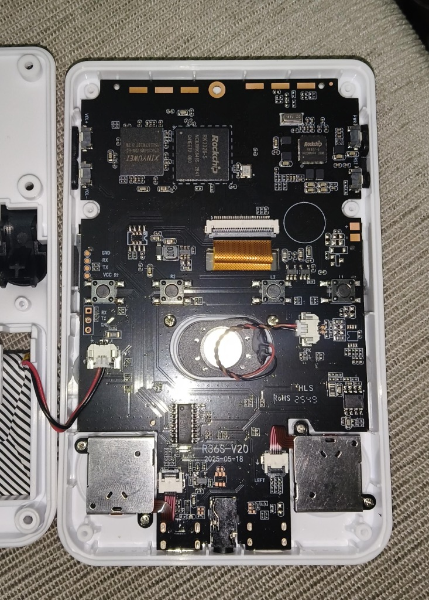

# dArkOSen-K36

[🇺🇸 Read in English (README.md)](README.md)

Solução híbrida, scripts automatizados e Device Tree (`DTS`/`DTB`) calibrado para rodar o **dArkOSen (Debian GNU/Linux 13 "Trixie", `glibc 2.41`, SDL2 `2.32.10`)** em placas clones **R36S-V20 `2025-05-18` (lote `2549`) / família K36** equipadas com processador **Rockchip RK3326-S** e módulo de RAM **Xinyuwei `XY6C256M32DM-H2` (768 MB físicos @ 328 MHz)**.

---

## Por que este projeto existe?

Quem tem essa revisão específica de clone (**R36S-V20 `2025-05-18` lote `2549`**) ficava preso entre dois extremos:

- **Sistemas novos (dArkOSen, ArkOS, dArkOS4Clone com Kernel `4.4.189`):** Não dão boot (tela preta ou travamento imediato), mesmo usando os DTBs beta da placa V20 `2025-05-18`.
- **Sistema funcional (ArkOS K36 / fábrica com Kernel `5.10.160`):** Dá boot normalmente, mas usa um *rootfs* do **Ubuntu 19.10 (`glibc 2.30`)**, descontinuado em 2020 — impedindo a execução de quase todos os jogos recentes do **PortMaster**.

**A solução:** Manter a camada física que funciona nesta placa (**Bootloader `DDR V2.08 @ 333 MHz` + Kernel `5.10.160` limpo + DTB calibrado**) e rodar por cima o **sistema operacional completo Debian 13 (`glibc 2.41`) do dArkOSen** em `ext4`.

---

## Raio-X Forense do Hardware (`R36S-V20 2025-05-18 2549`)

### Foto de Referência da Placa-Mãe
Se você está em dúvida se o seu clone tem exatamente esta revisão de hardware, abra a tampa traseira e procure pela placa preta com as marcações **`R36S-V20 2025-05-18`** e **`HLS RoHS 2549`**, com um único chip de RAM **`XINYUWEI`** ao lado do processador **`Rockchip RK3326-S`** e do PMIC **`RK817-5`**:

<p align="center">
  
</p>

Dados coletados diretamente do hardware (`rockchip-otp0`, `MIDR_EL1`, `/proc/iomem`, `idbloader` e `dmesg`):

| Componente | Especificação Real Detectada | Impacto no Sistema |
|---|---|---|
| **SoC / CPU** | **Rockchip `RK3326-S`** (4× Cortex-A35, OTP `52 4b 33 26`, SoC ID `33260001`) | Teto seguro de **1296 MHz @ `1.10V`** (`vdd_arm`). DTBs de Kernel 4.4 tentavam aplicar `1.35V` / `1.5 GHz`. |
| **GPU** | **ARM Mali-G31 MP1 r0p0** (`0x7093`, até `520 MHz`) | Driver do Kernel `5.10.160` é `g18p0` (**UK 11.38**); exige `libMali.so` compatível (`r13p0` / UK 11.38). |
| **Memória RAM** | **Xinyuwei `XY6C256M32DM-H2`** — **768 MB físicos reais** (`0x00200000`–`0x2fffffff`, ~717 MB utilizáveis) | Opera de forma estável apenas em **194 MHz e 328 MHz**. Escalar para `450/528/666/786 MHz` trava o console. |
| **Armazenamento** | **Sem eMMC e sem SPI Flash** (apenas MicroSD) | Como o DTB do Kernel `5.10` mantém o nó `mmc0` reservado, o slot TF1 é mapeado em **`/dev/mmcblk1`**. |
| **PMIC / Áudio** | **Rockchip `RK817`** (chip ID `0x8170` via I2C `0-0020`) | Amplificador externo satura com `spk-volume = <0x0b>`. Calibrado para **`spk-volume = <0x03>`**. |
| **Controles** | Driver proprietário **`zed_joystick`** → **`play_joystick`** | GUID SDL2 `19000f6a706c61795f6a6f7973746900` (diferente do `GO-Super Gamepad` esperado pelo dArkOSen). |
| **Tela** | Painel MIPI-DSI **`640×480 @ 59 Hz`** (4 lanes) | Sequência DSI compatível com `rf3536k4ka.dtb` / `rf3536k3ka.dtb`. |

### Por que os DTBs beta da `V20 2025-05-18` no dArkOSen não funcionam nesta placa?
1. **Bootloader incompatível:** O `idbloader` da imagem padrão do dArkOSen (MBR) não inicializa a RAM Xinyuwei de 768 MB a `333 MHz` — a placa trava antes mesmo de carregar o kernel ou o DTB.
2. **Frequência de RAM acima de 328 MHz:** Os DTBs beta da V20 foram feitos para unidades com 1 GB de RAM a `528/666 MHz`, enquanto o lote `2549` com Xinyuwei 768 MB congela acima de `328 MHz`.
3. **Diferença de Kernel (`4.4.189` vs `5.10.160`) e Particionamento:** O dArkOSen espera `root=/dev/mmcblk0p2` em `btrfs` e controles `GO-Super Gamepad`, enquanto esta revisão usa `mmcblk1p2` em `ext4` e `play_joystick`.

### Descoberta sobre o Kernel de fábrica ("RAM falsa")
Na análise do binário `Image` de fábrica (`5.10.160`, compilado por `pangjianwen@git` / `bruce@zed`), verificamos que o fabricante adulterou o reporte de memória (`si_meminfo` / `/proc/meminfo`) para somar **`+256 MB` falsos** (mostrando **973 MB** no RetroArch) ou dobrar a leitura (mostrando **~1,4 GB**), fazendo jogos do PortMaster sofrerem crash ao tentar alocar memória inexistente.
- **Correção:** Utilizamos o kernel **`5.10.160-gc18be26ca0ba-dirty` limpo do ArkOS K36 (`lw@git`)**, que mantém todos os drivers do hardware e reporta fielmente os **~717 MB reais** + **512 MB de Swap ZRam (`lz4`)**.

---

## Tamanhos de Cartão SD Suportados

Os scripts de particionamento leem automaticamente o total exato de setores do seu cartão (`/sys/block/<dev>/size`) e destinam todo o espaço restante à partição `EASYROMS` (`exFAT`). **Qualquer cartão MicroSD de 16 GB até 512 GB+ é suportado automaticamente:**

| Cartão MicroSD | `BOOT` (FAT16) | `ROOTFS` (Debian 13 `ext4`) | `EASYROMS` (`exFAT`) |
|---|---|---|---|
| **16 GB** (~14,9 GiB) | 500 MB | 9,5 GB (~2 GB livres) | ~4,9 GB |
| **32 GB** (~29,1 GiB) | 500 MB | 9,5 GB (~2 GB livres) | **~19,1 GB** |
| **64 GB** (~59,5 GiB) | 500 MB | 9,5 GB (~2 GB livres) | **~49,5 GB** |
| **128 GB** (~119 GiB) | 500 MB | 9,5 GB (~2 GB livres) | **~109 GB** |
| **256 GB+** | 500 MB | 9,5 GB (~2 GB livres) | **Todo o espaço restante** |

---

## Principais Correções Aplicadas

1. **Debian 13 (`glibc 2.41`) sobre Kernel `5.10.160` limpo:** `ROOTFS` convertido de `btrfs` para `ext4` (sem `orphan_file`/`metadata_csum_seed` para compatibilidade total com o `e2fsck` do `uInitrd`) + módulos do Kernel `5.10.160` transplantados para `/usr/lib/modules/`.
2. **Montagem de `/roms` (`exFAT`) sem cair em `Emergency Mode`:** Transplante da `libfuse.so.2.9.9` (`aarch64-linux-gnu`) necessária para o `mount.exfat-fuse` rodar no Debian 13 (que traz apenas `libfuse3.so.4`), somado à flag `nofail` no `/etc/fstab`.
3. **Aceleração Gráfica Mali-G31 (`UK 11.38`):** Alinhamento dos links `libMali.so` (64-bit e 32-bit) para `libmali-bifrost-g31-rxp0-gbm.so` (`r13p0` / **UK 11.38**), eliminando o erro `file /dev/mali0 is not of a compatible version (user 10.6, kernel 11.38)`.
4. **Trava Segura de RAM (`328 MHz`) + ZRam `512 MB` (`lz4`):** Desativa `opp-450000000` e `opp-528000000` no DTB calibrado, trava `/etc/dmc-settings.conf` em `328000000` e ativa 512 MB de swap ZRam (`lz4`) no boot.
5. **Controles (`play_joystick`) e Botões A/B:** Injeta o GUID do `play_joystick` no EmulationStation, RetroArch 64/32-bit, `gamecontrollerdb.txt` do sistema e PortMaster, `buttonmon.sh`, `ogage` e `fn_menu_watcher.sh`; define `InvertButtons = false` (`A` confirma, `B` volta).
6. **Áudio Calibrado (`RK817`) sem Estourar em 100%:** Reduz o ganho de hardware no DTB para **`spk-volume = <0x03>;`**, restaura o `/var/local/asound.state` real do K36 (`state.rockchiprk817`, `Playback Path = SPK`) e ativa o `hp_autoswitch.service` (troca automática alto-falante/fone).
7. **Relógio Persistente (sem Bateria RTC) e Fuso Automático:** Herda automaticamente o fuso horário do PC onde você rodar o script (funciona em qualquer país; também pode ser alterado direto no portátil em **Options → System → Change Time** ou **Start → System Settings → Date and Time**) e instala o `save-clock.service` para salvar a hora ao desligar.
8. **Logos do dArkOSen no Boot e na Bateria:** `logo.bmp` em `640×480` 24-bit com o cabeçalho BMP exato do U-Boot do K36 + novos ícones `battery_0..5.bmp` / `battery_fail.bmp` (`220×110`).

---

## Arquitetura do Projeto

```text
darkosen-k36/
├── pyproject.toml                  # Metadados PEP 621 e definição do pacote Python
├── darkosen_k36.py                 # Wrapper CLI (`python3 darkosen_k36.py ...`)
├── darkosen_k36/                   # Pacote Python Modular
│   ├── cli.py                      # ArgumentParser e roteamento de subcomandos
│   ├── config.py                   # Caminhos, constantes GPT e templates de configuração
│   ├── disk.py                     # Validação de segurança de disco e particionamento GPT
│   ├── patcher.py                  # Patchers de BOOT, ROOTFS, RetroArch, áudio e relógio
│   ├── builder.py                  # Fluxos principais (check, build, patch, ram-mode, resize)
│   ├── overlay_extractor.py        # Compilador de calibração DTS e extrator de overlay do K36
│   └── utils.py                    # Logs, execução de comandos e detecção de WSL2/fuso horário
├── assets/                         # Recursos estáticos de hardware e sistema organizados por categoria
│   ├── dtb/                        # Arquivos DTS/DTB calibrados (328 MHz seguro e 666 MHz experimental)
│   ├── boot_logos/                 # Logos de boot 640×480 e ícones de carregamento de bateria 220×110
│   ├── device_tools/               # Scripts para o portátil (Diagnostico_Hardware_Real.sh, Testar_RAM_Frequencia.sh)
│   └── rootfs_overlay/             # Módulos do Kernel 5.10.160, libfuse2, exfat-fuse, ALSA e controles play_joystick
└── docs/                           # Fotos de referência da placa-mãe e documentação
```

---

## Como Usar (Linux & Windows WSL2)

> **Aviso:** O `darkosen_k36.py` bloqueia SSDs NVMe e o disco do sistema, além de pedir confirmação explícita antes de formatar o cartão SD. Sempre confira o dispositivo correto com `lsblk` (ex.: `/dev/sda` ou `/dev/sdb`). **Não execute atualizações OTA oficiais do dArkOSen que sobrescrevam `/boot`**, pois elas trocam o Kernel `5.10.160` pelo `4.4.189`.

### 1. Verificar Dependências (Linux ou Windows WSL2 + `usbipd-win`)
```bash
python3 darkosen_k36.py check
```
*(No Windows: instale WSL2 + Ubuntu e `usbipd-win`, conecte o leitor USB de cartão SD no WSL2 e rode os comandos abaixo dentro do Ubuntu. Se o adaptador USB reportar `removable=0` no WSL2, passe `--allow-non-removable`.)*

### 2. Gravar um cartão SD do zero em um único comando (16 GB / 32 GB / 64 GB / 128 GB+)
Baixe e descompacte `ArkOS_K36_v2.0_08112025.img` e `dArkOSen_R36_11112026.img` em qualquer pasta do seu PC (não precisa copiar para dentro do projeto):
```bash
sudo python3 darkosen_k36.py build \
  --device /dev/sda \
  --k36 /caminho/para/ArkOS_K36_v2.0_08112025.img \
  --darkos /caminho/para/dArkOSen_R36_11112026.img
```
*(Flags opcionais: `--rootfs-gb 9.5`, `--experimental-ram`, `--timezone UTC`, `--dry-run`.)*

### 3. Aplicar apenas as correções mais recentes em um cartão já gravado
```bash
sudo python3 darkosen_k36.py patch --device /dev/sda
```

### 4. Redimensionar um cartão de 12 GB `ROOTFS` para 9.5 GB `ROOTFS`
```bash
sudo python3 darkosen_k36.py resize --device /dev/sda --rootfs-gb 9.5
```

### 5. [Experimental] Destravar Frequências Maiores de RAM (`450 / 528 / 666 MHz`)
Por padrão, o `darkosen-k36` mantém a RAM Xinyuwei travada com segurança em `328 MHz`. Se quiser testar se o chip da sua placa aguenta frequências maiores (**testado estável até `528 MHz` na nossa unidade lote `2549`!**) depois do boot:

```bash
# Ativar frequências experimentais de RAM (o boot continua seguro em 328 MHz)
sudo python3 darkosen_k36.py ram-mode --device /dev/sda --mode experimental

# Reverter para o DTB travado em 328 MHz a qualquer momento
sudo python3 darkosen_k36.py ram-mode --device /dev/sda --mode safe
```
> **Nota:** No portátil, abra **Options → Tools → `Testar_RAM_Frequencia`**. A alteração é **temporária** e inclui um teste SHA-256 de 64 MB — se travar em alguma frequência, basta reiniciar para voltar automaticamente para `328 MHz`.

---

## Créditos e Menção Honrosa

- **Menção honrosa e agradecimento especial a [`Plane-Customer3162`](https://www.reddit.com/user/Plane-Customer3162/)** por ter disponibilizado os arquivos originais de boot do cartão que funcionava depois que eu havia perdido o conteúdo do meu cartão original — sem esse dump, a engenharia reversa e esta compilação híbrida não teriam sido possíveis.
- **ArkOS** (`christianhaitian`), **ArkOS-K36** (`AeolusUX`), **dArkOSen** e à equipe do **PortMaster** pelos projetos incríveis para a comunidade.

## Licença

- Todos os scripts originais, documentação e assets próprios deste repositório estão sob a **[Licença MIT](LICENSE)**.
- Os módulos do Kernel Linux `5.10.160` (`.ko`), arquivos Device Tree (`.dts`/`.dtb`) e o binário `exfat-fuse` em `rootfs_overlay/` são regidos pela licença **GPL-2.0**.
- A biblioteca `libfuse2` (`libfuse.so.2.9.9`) é regida pela licença **LGPL-2.1**.
